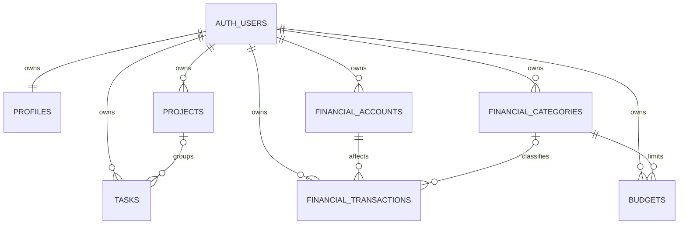

# IntheraNotes — Product Requirements Document (PRD)

**Versi:** 1.0 (MVP siap implementasi)  
**Tanggal:** 29 Oktober 2026  
**Bahasa aplikasi:** Indonesia (id-ID)  
**Mata uang awal:** Rupiah (IDR)  
**Zona waktu default:** Asia/Jakarta (WIB)  
**Platform utama:** Web responsif (desktop, tablet, mobile)  
**Kondisi proyek:** **Next.js sudah terpasang dan proyek sudah ada. JANGAN membuat proyek Next.js baru.**

---

## 0. Instruksi penting untuk Codex

Dokumen ini adalah spesifikasi produk **sekaligus panduan implementasi**. Tujuannya membangun aplikasi yang sungguh berfungsi, bukan hanya mockup atau landing page.

1. **Inspeksi repository yang ada terlebih dahulu**: cek `package.json`, versi Next.js, App Router/Pages Router, TypeScript/JavaScript, styling, komponen, package manager, konfigurasi lint/test, dan struktur direktori. Pertahankan konfigurasi serta kode yang sudah baik.
2. **Jangan menjalankan `create-next-app` dan jangan mengganti proyek yang ada.** Adaptasikan rancangan dengan stack yang tersedia. Jika proyek menggunakan App Router, tetap gunakan App Router; jika masih Pages Router, jelaskan opsi migrasi dan lakukan hanya bila aman.
3. Bangun **IntheraNotes** sebagai satu aplikasi dengan **dua modul inti**: **To-Do List** dan **Manajemen/Catatan Keuangan**, plus dashboard gabungan dan pengaturan.
4. Terapkan UI modern, rapi, cepat, responsif, menggunakan bahasa Indonesia. Seluruh tombol, halaman, form, filter, dan operasi pada MVP harus benar-benar terhubung dengan data.
5. Gunakan **Supabase (Auth + PostgreSQL + Row Level Security)** sebagai pilihan backend default apabila proyek belum memiliki backend/database. Jika repository sudah memiliki backend valid, gunakan yang ada dan jelaskan perbedaannya sebelum mengubah arsitektur. Simpan konfigurasi melalui environment variables; jangan hardcode credentials.
6. Gunakan TypeScript, Tailwind CSS, komponen bergaya shadcn/ui, ikon Lucide, dan library chart yang kompatibel **bila belum ada alternatif yang setara**. **Jangan menginstal dependensi ganda** untuk fungsi sama. Gunakan Zod untuk validasi payload.
7. Jika environment Supabase belum tersedia, **tetap selesaikan implementasi UI, schema, migration, repository/server actions, dan setup instructions**. Tampilkan halaman “Konfigurasi database diperlukan” yang jelas pada runtime; **jangan** menyajikan data dummy seolah-olah data nyata pengguna. Fixture/seed demo hanya untuk development/test yang dipisah jelas.
8. Kerjakan secara bertahap tetapi arah akhirnya adalah **MVP end-to-end**, bukan berhenti pada design system. Jalankan lint, typecheck, test, dan build; perbaiki semua error yang dapat ditangani.
9. Di hasil akhir, ringkas: fitur yang selesai, file penting yang berubah, migrasi/konfigurasi yang harus dijalankan pemilik proyek, hasil pengujian, dan keterbatasan yang masih ada.
10. **Prioritas implementasi:** P0 dulu sampai selesai → kemudian P1. Fitur P2 tidak wajib dibuat pada MVP dan jangan mengorbankan kualitas dasar untuk mengejarnya.

---

## 1. Ringkasan produk

**IntheraNotes** adalah aplikasi produktivitas pribadi yang menggabungkan **pengelolaan tugas harian** dan **pencatatan keuangan** dalam satu workspace sederhana. Pengguna dapat menyusun pekerjaan, menentukan prioritas, melihat deadline, mencatat pemasukan/pengeluaran/transfer, memantau saldo beberapa akun, mengatur anggaran bulanan, dan melihat ringkasan semuanya di satu dashboard.

**Tagline kerja:** *Rencanakan harimu. Pahami uangmu.*

### 1.1 Masalah pengguna

- Tugas tersebar antara catatan, chat, dan aplikasi berbeda, sehingga deadline mudah terlewat.
- Catatan uang tidak konsisten; pengguna kesulitan menjawab “bulan ini habis berapa dan untuk apa?”
- Menambah transaksi harian sering terasa ribet.
- Tidak ada overview sederhana yang menunjukkan progres produktivitas dan kondisi keuangan secara bersamaan.

### 1.2 Solusi

Satu dashboard dengan ringkasan tugas, transaksi cepat, saldo, pengeluaran bulan ini, dan anggaran. Dua area kerja memiliki navigasi jelas tetapi berbagi identitas visual, login, pencarian/filter, dan pola interaksi yang konsisten.

### 1.3 Pengguna utama

Pengguna individu di Indonesia: pelajar/mahasiswa, freelancer, profesional, dan pemilik usaha kecil yang ingin mengelola tugas pribadi serta uang harian. **MVP berorientasi satu akun pengguna, data privat, tanpa kolaborasi tim dan tanpa fitur akuntansi bisnis formal.**

### 1.4 Tujuan keberhasilan

- Pengguna baru dapat membuat tugas pertama dalam maksimal sekitar tiga langkah setelah login.
- Pengguna dapat menambahkan transaksi dalam alur cepat tanpa berpindah banyak halaman.
- Semua perhitungan saldo dan laporan konsisten, termasuk transfer antarakun.
- Aplikasi nyaman dipakai melalui layar ponsel maupun desktop.
- Data pengguna berbeda benar-benar terisolasi pada level database.

### 1.5 Non-goals MVP

Integrasi bank otomatis, dompet digital live, pembayaran, pemrosesan kartu, AI assistant, multiuser/team, invoice, perpajakan, stok produk, multi-currency, pembagian tagihan, utang-piutang kompleks, dan aplikasi native iOS/Android. Fitur tersebut masuk backlog potensial, bukan janji MVP.

---

## 2. Ruang lingkup dan prioritas

| ID | Fitur | Prioritas | Keterangan |
|---|---|---|---|
| AUTH-01 | Registrasi, login, logout | P0 | Email/password menggunakan Supabase Auth |
| AUTH-02 | Isolasi data per pengguna | P0 | Row Level Security dan pemeriksaan server-side |
| UI-01 | Layout responsif + sidebar/header + tema | P0 | Mobile navigation tersedia |
| DASH-01 | Dashboard gabungan | P0 | Tugas, saldo, pendapatan, pengeluaran, transaksi terkini |
| TASK-01 | CRUD tugas | P0 | Judul, deskripsi, tenggat, prioritas, status |
| TASK-02 | Daftar tugas dan filter | P0 | Semua, Hari Ini, Mendatang, Terlambat, Selesai |
| TASK-03 | Tandai selesai/buka kembali | P0 | Progres aktual tersimpan |
| TASK-04 | Proyek/kategori tugas | P1 | Pengelompokan tugas, tidak wajib untuk quick add |
| TASK-05 | Cari, urut, dan filter lanjutan | P1 | Status, prioritas, tanggal, proyek |
| FIN-01 | Akun keuangan dan saldo awal | P0 | Tunai, bank, e-wallet, lainnya |
| FIN-02 | Catat pemasukan, pengeluaran, transfer | P0 | Form valid dan update laporan otomatis |
| FIN-03 | Daftar transaksi + edit/hapus + filter | P0 | Search, jenis, kategori, akun, periode |
| FIN-04 | Kategori pemasukan/pengeluaran | P0 | Kategori bawaan + kategori milik pengguna |
| FIN-05 | Ringkasan bulanan dan chart sederhana | P0 | Pendapatan, pengeluaran, arus kas bersih |
| FIN-06 | Anggaran bulanan per kategori | P1 | Target vs realisasi; peringatan limit |
| FIN-07 | Laporan dan ekspor CSV | P1 | Bulan/rentang tanggal; file UTF-8 |
| SYS-01 | Validasi, loading, toast, empty/error states | P0 | Bukan hanya tampilan statis |
| SYS-02 | Settings: profil, preferensi tema | P1 | Mata uang tetap IDR di MVP |
| SYS-03 | Test penting + README/setup | P0 | MVP dapat dijalankan oleh developer lain |

**Definisi P0:** Harus selesai agar MVP layak digunakan. **P1:** Target setelah P0 stabil, masih dalam rilis 1.0 bila memungkinkan. **P2:** Future enhancement.

---

## 3. Struktur informasi dan navigasi

### 3.1 Menu desktop

**Sidebar** (dapat collapse) dengan dua kelompok:

- **Umum:** Dashboard
- **Produktivitas:** Tugas, Hari Ini, Mendatang, Proyek (P1)
- **Keuangan:** Ringkasan, Transaksi, Akun, Anggaran (P1), Laporan (P1)
- **Bawah:** Pengaturan, Profil, Logout

### 3.2 Route yang disarankan

| Route | Tujuan |
|---|---|
| `/login` | Login |
| `/register` | Registrasi |
| `/dashboard` | Overview dua modul |
| `/tasks` | Daftar semua tugas |
| `/tasks/today` | Tugas dengan tenggat hari ini + tugas tertunda yang masih aktif (dibedakan visualnya) |
| `/tasks/upcoming` | Tugas aktif dengan tenggat setelah hari ini |
| `/tasks/projects` | Proyek/kategori tugas (P1) |
| `/finance` | Ringkasan keuangan |
| `/finance/transactions` | Riwayat transaksi + pencarian/filter |
| `/finance/accounts` | Daftar akun/saldo |
| `/finance/budgets` | Anggaran (P1) |
| `/finance/reports` | Laporan dan ekspor (P1) |
| `/settings` | Preferensi profil dan tampilan |

Default root `/` mengarahkan pengguna yang sudah login ke `/dashboard`; yang belum login ke `/login`.

### 3.3 Mobile navigation

Header ringkas, drawer/sheet untuk sidebar, bottom navigation 3–4 item utama (Dashboard, Tugas, Keuangan, Lainnya) bila sesuai desain, CTA cepat “Tambah” mudah dijangkau. Semua form bisa digunakan tanpa horizontal scrolling.

---

## 4. Prinsip pengalaman dan identitas visual

**Arah desain:** aplikasi SaaS personal modern, clean dan premium; kombinasi kerapian workspace produktivitas dengan keterbacaan dashboard finansial. **Jangan menyalin persis UI/brand produk lain.**

- **Nuansa:** tenang, fokus, banyak whitespace, tidak penuh dekorasi atau gradient berlebihan.
- **Warna:** dasar netral; aksen utama indigo/violet yang konsisten untuk CTA/active nav; hijau untuk pemasukan; merah/rose untuk pengeluaran; amber untuk perhatian/overdue.
- **Tipografi:** hierarki jelas, angka keuangan mudah dibaca dengan `tabular-nums`.
- **Bentuk:** radius sedang, divider halus, shadow minimal, komponen card secukupnya.
- **Tema:** Light dan Dark Mode; preferensi pengguna disimpan (P1), default mengikuti sistem.
- **Micro-interaction:** hover/focus halus, checkbox selesai memiliki transisi singkat; hormati `prefers-reduced-motion`.
- **Aksesibilitas:** semantic HTML, label input, navigasi keyboard, focus ring nyata, kontras memadai, dialog fokus terkelola, status tidak disampaikan lewat warna saja.
- **Ikon:** Lucide; hindari emoji sebagai ikon utama UI.
- **Bahasa teks:** Bahasa Indonesia natural. Contoh: “Tambah tugas”, “Catat transaksi”, “Pengeluaran bulan ini”, “Belum ada tugas”.

### 4.1 Responsive breakpoints

- Mobile kecil: 320–639px; konten satu kolom, bottom sheet/dialog sesuai ukuran.
- Tablet: 640–1023px; grid 2 kolom bila ruang cukup.
- Desktop: ≥1024px; sidebar tetap dan ringkasan dalam grid 3–4 kolom.
- Jangan mengandalkan angka breakpoint literal tertentu jika proyek sudah punya sistem responsif konsisten.

### 4.2 States wajib untuk setiap operasi

Initial loading/skeleton, empty state dengan CTA, validation error inline, unauthorized/forbidden, generic recoverable error, network failure dengan retry, saving/disabled submit, success toast atau status, dan konfirmasi sebelum penghapusan permanen.

---

## 5. Modul A — To-Do List

### 5.1 Model tugas

Tugas berisi:

- **Judul** (wajib, 1–160 karakter)
- Deskripsi (opsional, plain text atau textarea, maksimal 5.000 karakter)
- Status: `todo`, `in_progress`, `done`
- Prioritas: `low`, `medium`, `high` (default `medium`)
- Tanggal jatuh tempo (`due_date` opsional, tipe `DATE`)
- Proyek (`project_id` opsional, P1)
- Waktu dibuat, diperbarui, dan diselesaikan (`completed_at`)
- `user_id` sebagai pemilik

**Status dan tenggat berbeda:** Task overdue jika status bukan `done` dan `due_date` kurang dari tanggal hari ini menurut Asia/Jakarta. Task tanpa due date tidak dianggap overdue.

### 5.2 Flow pengguna

1. Klik **Tambah tugas** pada dashboard atau halaman tugas.
2. Form quick-add menampilkan Judul; opsi lanjutan dapat dibuka (tanggal, prioritas, deskripsi, proyek P1).
3. Klik Simpan: validasi; data masuk database; daftar dan metrik terkait diperbarui.
4. Klik checkbox/aksi status untuk menandai selesai; tampilkan state selesai; `completed_at` diset.
5. Klik lagi untuk membuka kembali; kembalikan status `todo` dan kosongkan `completed_at`.
6. Pengguna dapat edit dan hapus; hapus membutuhkan confirmation dialog.

### 5.3 Halaman Tugas

- Header “Tugas Saya”, jumlah tugas aktif, tombol Tambah Tugas.
- Search dan filter (semua/aktif/selesai, prioritas, urutan tenggat).
- List dengan checkbox, judul, badge prioritas, tanggal jatuh tempo, penanda terlambat, menu opsi.
- Area pengelompokan yang berguna: **Terlambat**, **Hari Ini**, **Mendatang**, **Tanpa Tenggat**, **Selesai** (bisa berupa tabs/filter agar UI tidak sesak).
- Saat data kosong: ilustrasi sederhana opsional, pesan jelas, CTA pertama.
- Aksi lengkap tersedia di perangkat mobile.

### 5.4 Halaman Hari Ini

- Tugas belum selesai dengan due date hari ini.
- Tugas terlambat ditampilkan dalam section terpisah bernama “Perlu perhatian” (jangan disamarkan menjadi due hari ini).
- Mini-counter: selesai hari ini, aktif hari ini, terlambat.

### 5.5 Proyek (P1)

CRUD proyek personal: `name`, `color`, `description` opsional. Project bisa diarsipkan. Tugas tetap ada saat proyek dihapus: minta pengguna memindahkan atau lepaskan hubungan proyek sebelum penghapusan.

### 5.6 Aturan dan edge cases

- Trim whitespace, larang judul kosong.
- `due_date` merupakan tanggal kalender, bukan timestamp UTC; perubahan zona waktu browser tidak boleh mengubah tanggal yang tersimpan.
- Pengubahan `status=done` melalui editor juga mengisi `completed_at`; mengubah menjadi aktif mengosongkannya.
- Metrik “selesai hari ini” diambil dari `completed_at` dalam Asia/Jakarta.
- Task user A tidak dapat dibaca/diubah user B lewat URL, query, maupun request manual.
- List besar menggunakan pagination atau incremental loading; bukan render semua record tanpa batas.

---

## 6. Modul B — Keuangan Pribadi

### 6.1 Ruang lingkup

Pencatatan keuangan **manual** untuk penggunaan pribadi. Pengguna membuat beberapa akun, menyimpan saldo awal, mencatat transaksi, dan menganalisis pemasukan, pengeluaran, dan anggaran. Aplikasi **bukan** penghubung rekening bank serta tidak melakukan transfer uang sungguhan; “transfer” hanya perpindahan saldo yang dicatat secara internal.

### 6.2 Akun keuangan

Tipe akun: `cash`, `bank`, `ewallet`, `other`.

Field: nama akun (wajib, maksimal 80 karakter), tipe, saldo awal dalam bilangan bulat rupiah, tanggal pembukaan opsional, warna/ikon opsional, status aktif/arsip, pengguna pemilik.

Contoh akun: Tunai, BCA, DANA, Tabungan.

**Saldo saat ini** dihitung secara deterministik:

`saldo = saldo_awal + total_pemasukan - total_pengeluaran + transfer_masuk - transfer_keluar`

Jangan menyimpan field saldo mutabel yang diperbarui terpisah dari transaksi tanpa alasan dan mekanisme konsistensi yang sangat jelas. Utamakan perhitungan berbasis ledger (view/query/aggregate) sehingga tidak terjadi double-counting.

**Catatan:** Saldo awal bukan pendapatan, tidak masuk total pemasukan bulan ini. Akun bisa menunjukkan saldo negatif (misal koreksi/backdate); tampilkan peringatan namun jangan diam-diam memodifikasi nominal.

### 6.3 Tipe transaksi

#### A. Pemasukan (`income`)
- Nominal positif (> 0) dalam rupiah
- Tanggal transaksi (wajib, default hari ini Asia/Jakarta)
- Akun tujuan (wajib)
- Kategori pemasukan (wajib)
- Judul/catatan singkat (opsional)
- Catatan detail (opsional)

Efek: saldo akun bertambah, masuk ringkasan income pada bulan sesuai tanggal transaksi.

#### B. Pengeluaran (`expense`)
- Field sama dengan pemasukan; akun sumber wajib dan kategori pengeluaran wajib.

Efek: saldo akun berkurang, masuk ringkasan expense dan realisasi anggaran kategori.

#### C. Transfer internal (`transfer`)
- Nominal positif (> 0)
- Tanggal
- Akun asal dan akun tujuan (wajib, berbeda, milik user sama)
- Catatan opsional
- **Tidak memiliki kategori pemasukan/pengeluaran**

Efek: akun asal berkurang dan akun tujuan bertambah dengan nominal yang sama. **Tidak boleh** dihitung sebagai pendapatan, pengeluaran, atau konsumsi anggaran. Seluruh perubahan transfer tercatat dan disimpan sebagai satu operasi atomik.

### 6.4 Kategori default

**Pengeluaran:** Makanan & Minuman, Transportasi, Belanja, Tagihan, Hiburan, Kesehatan, Pendidikan, Rumah Tangga, Lainnya.

**Pemasukan:** Gaji, Freelance, Bisnis, Hadiah, Investasi, Lainnya.

Kategori bawaan dibuat sebagai data per pengguna ketika onboarding (hindari pengguna dapat saling mengubah kategori global). Pengguna dapat membuat kategori sendiri, edit nama/keterangan, dan mengarsipkan kategori. Kategori yang sudah digunakan tidak dapat dihapus begitu saja hingga transaksi dipindah kategori. Nama kategori unik secara case-insensitive per user dan tipe (atau beri pesan duplicate yang jelas).

### 6.5 Quick Add Transaksi

- Tombol **Catat Transaksi** tersedia di dashboard dan seluruh bagian keuangan.
- Dialog/sheet dengan segmented control **Pengeluaran | Pemasukan | Transfer**.
- Nominal paling menonjol; input format rupiah jelas dan aman.
- Untuk expense/income: kategori dan akun wajib.
- Untuk transfer: pilih asal/tujuan tanpa kategori.
- Form memiliki tanggal dan catatan; shortcut Enter/submit bila aman.
- Saat simpan sukses, tutup modal, tampilkan feedback, refresh kartu saldo/summary/transaksi.

### 6.6 Halaman Ringkasan Keuangan `/finance`

Komponen:

1. Summary cards: **Total Saldo**, **Pemasukan Bulan Ini**, **Pengeluaran Bulan Ini**, **Arus Kas Bersih Bulan Ini** (`income - expense`).
2. Chart pemasukan vs pengeluaran per hari atau per minggu pada bulan terpilih. Gunakan nol untuk rentang tanpa transaksi, bukan grafik rusak.
3. Breakdown kategori pengeluaran bulan terpilih (bar/donut; jika data kurang gunakan list).
4. Daftar akun dengan saldo masing-masing.
5. 5–10 transaksi terbaru dengan link ke semua transaksi.
6. Filter bulan/tahun yang mempengaruhi kartu alur bulanan, chart, breakdown, dan transaksi. **Total Saldo** merupakan saldo terkini lintas waktu dan harus diberi label berbeda agar tidak disalahartikan sebagai saldo akhir bulan terpilih.
7. CTA Catat Transaksi.

### 6.7 Halaman Transaksi `/finance/transactions`

- Tabel responsif/list pada mobile.
- Field tampilan: tanggal, kategori/jenis, akun, catatan, nominal dengan +/−, tindakan.
- Transfer ditampilkan sebagai satu baris, menyebut akun asal → akun tujuan dan nominal netral.
- Filter: rentang tanggal, bulan, tipe, akun, kategori; search catatan.
- Sorting: terbaru, terlama, nominal terbesar/terkecil.
- Pagination server-side, default 20–30 item per halaman.
- Aksi edit dan hapus dengan konfirmasi; perubahan akan langsung tercermin di kalkulasi saldo serta laporan.

### 6.8 Anggaran `/finance/budgets` (P1)

- Satu anggaran per kategori pengeluaran untuk satu bulan (`YYYY-MM`).
- Field: kategori, bulan, batas nominal positif.
- Progres = total pengeluaran kategori pada bulan terpilih / batas anggaran × 100%.
- Warnai threshold 80% dan 100% dengan label tekstual selain warna.
- Pengeluaran melampaui anggaran **tetap boleh dicatat**, UI memberikan peringatan.
- Income, transfer, saldo awal, dan transaksi dari bulan lain tidak masuk realisasi.
- **Tidak ada rollover otomatis pada MVP.**
- Pengeditan/hapus transaksi mengubah realisasi anggaran otomatis.

### 6.9 Laporan `/finance/reports` (P1)

- Pilih bulan atau tanggal awal–akhir.
- Tampilan total income, expense, net cash flow, ranking kategori pengeluaran, dan tren waktu.
- Ekspor **CSV UTF-8** untuk transaksi yang lolos filter dengan header Indonesia: Tanggal, Jenis, Kategori, Akun Asal, Akun Tujuan, Nominal (IDR), Catatan.
- CSV aman dari formula injection: nilai teks yang dimulai `=`, `+`, `-`, `@`, tab, atau carriage return disanitasi untuk konteks spreadsheet. Escape quote/delimiter sesuai CSV.
- Ekspor hanya data yang dimiliki pengguna login.

### 6.10 Aturan uang dan edge cases penting

- **Semua nominal disimpan sebagai integer rupiah (`BIGINT` pada PostgreSQL); jangan menggunakan float JavaScript untuk perhitungan finansial.** Konversi nilai BIGINT dari database ke client menggunakan string decimal jika melebihi batas aman JS; parser/formatter harus aman.
- IDR pada MVP tidak memakai angka pecahan/desimal. Input `Rp 25.000` diparse menjadi integer `25000`; jangan salah menganggap titik sebagai pemisah desimal.
- Tanggal transaksi berupa `DATE`, diperlakukan sebagai tanggal lokal Indonesia. Default hari ini dihitung Asia/Jakarta di server.
- Edit/delete transaksi bersifat konsisten: karena saldo adalah hasil agregasi ledger, perubahan otomatis menghasilkan saldo baru tanpa menggandakan efek.
- Jika kategori ingin dinonaktifkan, transaksi historis tetap memuat kategori itu.
- Jika akun punya transaksi, lebih aman **arsipkan akun** daripada hard delete. Akun arsip tidak ditawarkan pada transaksi baru tetapi tetap tampil pada riwayat terkait, serta dapat dibuka kembali.
- Tolak transfer akun asal = akun tujuan dan transfer lintas pengguna.
- Jangan mencatat transfer sebagai dua transaksi income/expense terpisah.
- Transaksi berjumlah nol/negatif ditolak; tanda +/− adalah efek jenis transaksi, bukan nilai input.
- Perubahan tanggal transaksi dapat memindahkan kontribusi income/expense dan anggaran ke bulan lain.
- Jika pengguna punya banyak akun, total saldo = jumlah saldo seluruh akun yang belum dihapus, termasuk akun arsip agar histori tetap konsisten; tampilkan penjelasan bila perlu.
- Proses perubahan mutasi berlangsung di server, diverifikasi ulang user + kepemilikan ID; jangan percaya `user_id` dari client.

---

## 7. Dashboard gabungan `/dashboard`

### 7.1 Komponen wajib (P0)

**Header:** ucapan kontekstual netral, tanggal hari ini (WIB), tombol utama **+ Tambah** yang dapat memilih “Tugas” atau “Transaksi”.

**Top summary cards (4 buah):**

1. **Tugas Aktif** — total `todo` + `in_progress`.
2. **Selesai Hari Ini** — jumlah task dengan `completed_at` hari ini dalam WIB.
3. **Total Saldo** — dari semua akun (termasuk yang diarsipkan).
4. **Pengeluaran Bulan Ini** — hanya transaksi jenis `expense` pada bulan berjalan WIB.

**Bagian konten:**
- **Fokus Hari Ini:** tugas jatuh tempo hari ini dan tugas terlambat, dengan checkbox aksi cepat dan link “Lihat semua”.
- **Ringkasan Keuangan:** Pemasukan, Pengeluaran, Arus Kas Bersih bulan berjalan, visual kecil yang informatif.
- **Transaksi Terakhir:** 5 transaksi terkini; click menuju halaman transaksi.
- **Aksi Cepat:** tambah tugas, catat pengeluaran, catat pemasukan, transfer antarakun.

### 7.2 Jika pengguna baru

State onboarding informatif: “Mulai dengan tugas pertamamu” dan “Buat akun keuangan untuk mulai mencatat uang”. Jangan memunculkan grafik fiktif atau saldo palsu. Metrik dapat 0 jika valid; belum membuat akun menunjukkan CTA.

### 7.3 Performance

Kalkulasi metrik di server secara agregat; hindari mengambil seluruh data ke browser untuk menghitung dashboard. Setelah mutasi, revalidate/refresh jalur yang relevan saja.

---

## 8. Authentication dan onboarding

### 8.1 Registrasi

Input: nama tampilan (opsional, maksimal 80), email, password, konfirmasi password (UI). Gunakan Supabase Auth, alur verifikasi email sesuai konfigurasi project. Jelaskan jika email verification diperlukan; jangan berpura-pura login berhasil sebelum session ada.

### 8.2 Login/logout

- Email + password.
- Error aman dan sederhana (hindari user enumeration berlebihan).
- Session dikelola dengan library SSR resmi yang cocok dengan versi Next.js.
- Redirect setelah login ke dashboard atau halaman tujuan yang aman.
- Logout menghapus session kemudian redirect login.

### 8.3 Onboarding setelah login pertama

- Buat/isi profil pengguna dan kategori keuangan default idempotent.
- Tampilkan pilihan buat akun pertama (misalnya “Tunai”) dengan saldo awal opsional; pengguna boleh melewati onboarding dan membuat akun nanti.
- Jangan langsung membuat saldo atau transaksi demo.

### 8.4 Reset password

P1 bila alurnya memerlukan tambahan konfigurasi email. Minimal sediakan UI dan instruksi yang akurat, atau implementasikan secara lengkap jika setup memungkinkan.

---

## 9. Data model — PostgreSQL / Supabase

Gunakan UUID primary key, foreign key yang tepat, timestamps dengan `timestamptz`, tanggal kalender dengan `date`, serta uang `bigint` rupiah. Semua tabel data pengguna di bawah harus mempunyai `user_id` dan kebijakan RLS.

### 9.1 `profiles`

| Kolom | Tipe | Aturan |
|---|---|---|
| `id` | uuid PK | Referensi `auth.users.id`, ON DELETE CASCADE |
| `display_name` | text | Nullable, length max 80 |
| `timezone` | text | Default `Asia/Jakarta` (MVP terkunci ke WIB untuk kalkulasi) |
| `theme` | text | `system`, `light`, `dark` |
| `created_at`, `updated_at` | timestamptz | Default now |

Untuk `profiles`, `id` adalah pemilik; RLS `id = auth.uid()`.

### 9.2 `projects` (P1)

`id uuid PK`, `user_id uuid FK auth.users`, `name text`, `description text nullable`, `color text nullable`, `is_archived boolean default false`, `created_at`, `updated_at`.

### 9.3 `tasks`

`id uuid PK`, `user_id uuid FK`, `project_id uuid FK projects nullable`, `title varchar(160) not null`, `description text nullable`, `status text check (todo/in_progress/done)`, `priority text check (low/medium/high)`, `due_date date nullable`, `completed_at timestamptz nullable`, `created_at`, `updated_at`.

Index disarankan: `(user_id, status, due_date)`, `(user_id, created_at desc)`. Pastikan task dan project yang berelasi milik user sama pada server dan/atau DB trigger/policy.

### 9.4 `financial_accounts`

`id uuid PK`, `user_id uuid FK`, `name varchar(80) not null`, `type text check (cash/bank/ewallet/other)`, `opening_balance bigint not null default 0`, `opened_on date nullable`, `is_archived boolean not null default false`, `created_at`, `updated_at`.

Index `(user_id, is_archived)`. Opening balance boleh nonnegatif atau negatif secara eksplisit (misalnya rekening overdraft), tetapi UI harus menjelaskan sifatnya. Akun dengan histori tidak boleh dihapus tanpa kebijakan jelas; implementasikan arsip sebagai aksi utama.

### 9.5 `financial_categories`

`id uuid PK`, `user_id uuid FK`, `name varchar(80) not null`, `type text check (income/expense)`, `is_default boolean default false`, `is_archived boolean default false`, `created_at`, `updated_at`.

Unique secara case-insensitive per `(user_id, type, lower(name))` bila memungkinkan lewat expression index. Kategori yang berhubungan dengan transaksi tidak boleh dihapus secara cascade.

### 9.6 `financial_transactions`

| Kolom | Tipe | Aturan |
|---|---|---|
| `id` | uuid PK | Random UUID |
| `user_id` | uuid FK | Wajib, pemilik |
| `type` | text | `income`, `expense`, `transfer` |
| `amount` | bigint | Wajib `> 0` |
| `transaction_date` | date | Wajib |
| `account_id` | uuid FK nullable | Untuk income/expense |
| `from_account_id` | uuid FK nullable | Untuk transfer |
| `to_account_id` | uuid FK nullable | Untuk transfer |
| `category_id` | uuid FK nullable | Wajib income/expense; kosong untuk transfer |
| `title` | varchar(160) nullable | Label/catatan ringkas |
| `notes` | text nullable | Detail opsional |
| `created_at`, `updated_at` | timestamptz | Default now |

**Constraint database wajib (atau trigger equivalent):**

- `type IN ('income','expense')`: `account_id` dan `category_id` tidak null, `from_account_id` serta `to_account_id` null.
- `type='transfer'`: `account_id` dan `category_id` null, `from_account_id` dan `to_account_id` tidak null serta berbeda.
- Referensi akun/kategori/proyek tidak boleh milik user berbeda. Cegah melalui database constraint/trigger atau secured RPC yang diikuti validasi server, **bukan hanya validasi client**.
- Tipe kategori harus cocok dengan tipe transaksi (`income` ↔ income, `expense` ↔ expense).
- Foreign key delete memakai restrict untuk data historis.

Index: `(user_id, transaction_date desc)`, `(user_id, type, transaction_date)`, `(user_id, account_id)`, `(user_id, from_account_id)`, `(user_id, to_account_id)`, `(user_id, category_id, transaction_date)`.

### 9.7 `budgets` (P1)

`id uuid PK`, `user_id uuid FK`, `category_id uuid FK`, `month date` (wajib hari pertama bulan), `limit_amount bigint > 0`, `created_at`, `updated_at`. Unique `(user_id, category_id, month)`. Kategori harus tipe expense dan milik user yang sama.

### 9.8 ERD ringkas



**Catatan ERD:** hubungan akun ke transaksi mencakup `account_id`, `from_account_id`, dan `to_account_id`; satu diagram generik tidak menampilkan ketiganya secara eksplisit.

### 9.9 RLS (wajib)

Aktifkan `ENABLE ROW LEVEL SECURITY` untuk `profiles`, `projects`, `tasks`, `financial_accounts`, `financial_categories`, `financial_transactions`, `budgets`.

- Policies SELECT, INSERT, UPDATE, DELETE memeriksa `auth.uid() = user_id`; pada profiles menggunakan `auth.uid() = id`.
- Gunakan `WITH CHECK` untuk INSERT/UPDATE supaya user tidak dapat mengganti pemilik record.
- Validasi relasi ID lintas tabel (terutama transfer) tidak cukup dengan kebijakan ownership pada row transaksi saja; wajib ada pemeriksaan ownership relation yang aman.
- Tidak memberi akses luas `anon` ke tabel privat.
- `SUPABASE_SERVICE_ROLE_KEY` tidak diekspos ke client; utamakan user-scoped Supabase client dengan RLS.
- Buat migrasi SQL versioned, bukan langkah manual SQL yang tidak bisa direproduksi.

---

## 10. Aturan kalkulasi, query, dan format data

### 10.1 Persamaan inti

Untuk akun `A`:

```text
balance(A)
 = opening_balance(A)
 + SUM(income.amount WHERE income.account_id = A)
 - SUM(expense.amount WHERE expense.account_id = A)
 + SUM(transfer.amount WHERE transfer.to_account_id = A)
 - SUM(transfer.amount WHERE transfer.from_account_id = A)
```

Untuk bulan `M`, semua agregasi mengacu pada `transaction_date` (DATE) dengan batas `[tanggal_awal_bulan, tanggal_awal_bulan_berikutnya)`:

```text
income(M)    = SUM(amount WHERE type = income AND date in M)
expense(M)   = SUM(amount WHERE type = expense AND date in M)
net_flow(M)  = income(M) - expense(M)
budget_used(category, M) = SUM(amount WHERE type = expense AND category = category AND date in M)
```

Transfer tidak masuk `income`, `expense`, `net_flow`, atau `budget_used`.

### 10.2 Contoh penerimaan akuntansi

Akun Tunai saldo awal Rp500.000, Bank saldo awal Rp1.000.000. Catat pengeluaran Rp50.000 dari Tunai, pemasukan Rp200.000 ke Bank, dan transfer Rp100.000 dari Bank ke Tunai.

- Tunai akhir = Rp550.000.
- Bank akhir = Rp1.100.000.
- Total saldo akhir = Rp1.650.000.
- Pemasukan periode = Rp200.000.
- Pengeluaran periode = Rp50.000.
- Arus kas bersih = +Rp150.000.
- Transfer Rp100.000 **tidak** menambah pemasukan/pengeluaran.

### 10.3 Format mata uang

Tampilkan `Rp 1.250.000` (menggunakan `Intl.NumberFormat('id-ID', { style: 'currency', currency: 'IDR', maximumFractionDigits: 0 })` atau format setara), minus untuk pengeluaran. Simpan angka integer. Jangan menyimpan string berformat `Rp` dalam database.

### 10.4 Date and time

- UI default WIB, ditampilkan sebagai tanggal kalender yang stabil.
- Server menentukan hari/bulan saat ini berdasarkan `Asia/Jakarta`, **bukan** timezone host/deployment yang mungkin UTC.
- Timestamps `created_at`, `updated_at`, `completed_at` disimpan `timestamptz` UTC dan dikonversi ke WIB untuk pengelompokan lokal.
- `due_date` dan `transaction_date` tersimpan sebagai `DATE` tanpa konversi timezone yang menggeser hari.

### 10.5 Error dan konsistensi

Seluruh write yang melibatkan relasi lintas akun harus atomic di DB (satu baris transaksi transfer + validasi server/DB). Refresh query/route setelah mutation. Tidak boleh ada dua request submit yang menggandakan transaksi karena tombol tidak di-disable saat saving; untuk protection lebih kuat siapkan idempotency key P1 bila diperlukan.

---

## 11. Rekomendasi arsitektur aplikasi

### 11.1 Stack target (adaptif ke repository)

- **Framework:** Next.js yang sudah terinstal, TypeScript bila tersedia, App Router disarankan.
- **UI:** Tailwind CSS + komponen reusable berbasis shadcn/ui atau komponen existing setara.
- **Icons:** `lucide-react`.
- **Form & validation:** React Hook Form + Zod atau alternatif existing setara.
- **Backend:** Supabase Auth, PostgreSQL, RLS, SSR helpers resmi/terkompatibel.
- **Data writes:** Server Actions atau route handlers dengan autentikasi + Zod + ownership validation.
- **Charts:** Recharts atau alternatif existing ringan.
- **Feedback:** toast/sonner atau existing equivalent.
- **Testing:** Vitest untuk unit/integrasi; Playwright untuk smoke E2E bila cocok dengan repo.

**Penting:** Codex harus menggunakan versi paket yang benar-benar kompatibel dengan versi Next/React yang sudah ada, bukan mengikuti contoh usang dari internet secara membabi buta.

### 11.2 Struktur folder (contoh, jangan memaksakan bila sudah ada)

```text
src/
  app/
    (auth)/login/page.tsx
    (auth)/register/page.tsx
    (app)/layout.tsx
    (app)/dashboard/page.tsx
    (app)/tasks/page.tsx
    (app)/tasks/today/page.tsx
    (app)/tasks/upcoming/page.tsx
    (app)/finance/page.tsx
    (app)/finance/transactions/page.tsx
    (app)/finance/accounts/page.tsx
    (app)/finance/budgets/page.tsx
    (app)/finance/reports/page.tsx
    (app)/settings/page.tsx
  components/
    layout/        # sidebar, header, mobile nav
    shared/        # page heading, empty state, date picker, currency input
    tasks/         # task list, task item, task form
    finance/       # transaction form, account card, budget progress, chart
    ui/            # buttons, dialogs, fields, table, popover
  lib/
    supabase/      # browser/server client, auth helpers
    validations/   # zod schema
    finance/       # date range, money formatting, aggregations
    queries/       # reads with user-scoped auth
    actions/       # mutation server actions
  types/
  test/
supabase/migrations/
README.md
.env.example
```

### 11.3 Reusability

Buat reusable `AppShell`, `PageHeader`, `SummaryCard`, `EmptyState`, `ConfirmDialog`, `CurrencyInput`, `MonthPicker`, `TaskForm`, `TransactionForm`, `AccountForm`, `DataTable/TransactionList`. Hindari satu file sangat besar berisi seluruh aplikasi.

### 11.4 Data access dan security boundary

- Server-side verify current user untuk protected route dan setiap mutasi.
- Query semua data dibatasi user sesuai RLS.
- Tidak percaya `user_id`, `balance`, `type`, atau `amount` yang disodorkan client tanpa verifikasi.
- Untuk laporan, prioritaskan SQL aggregate/RPC yang user-scoped agar efisien.
- Jangan mengirim seluruh histori ke client untuk dihitung jika data dapat diagregasi di server.

---

## 12. Spesifikasi komponen dan interaksi detail

### 12.1 Topbar

- Logo teks **IntheraNotes** (buat wordmark teks sederhana, tidak perlu file logo jika aset belum disediakan).
- Context page title dan search kontekstual bila masuk akal.
- CTA Tambah yang mudah terlihat, avatar/profile menu.
- Pada mobile, menu drawer jelas dengan aria label.

### 12.2 Sidebar

- Active state sesuai pathname.
- Group label kecil, ikon minimal.
- Collapsible desktop dengan state konsisten, mobile sheet.
- Link tidak menampilkan halaman kosong 404: untuk P1 yang belum dibuat, sembunyikan hingga implementasi siap.

### 12.3 Task card/list item

- Checkbox status, judul, badge priority, tanggal, menu tindakan.
- Judul yang panjang harus wrap/truncate dengan akses ke detail lengkap.
- Tugas overdue memiliki label “Terlambat”.
- Tugas selesai visual berkurang intensitas tetapi tetap terbaca.

### 12.4 Input nominal

- Menampilkan format rupiah saat input/focus-blur tanpa mengubah nilai sebenarnya.
- Mobile numeric keyboard.
- Validasi kosong, nol, nilai tidak valid, overflow.
- Tidak mengizinkan bilangan pecahan untuk IDR.
- Simpan angka lewat tipe aman (`bigint` di server; serialize ke string untuk API/props jika perlu).

### 12.5 Chart

- Wajib ada label, tooltip dengan nilai rupiah, legend bila multi-series.
- Chart tidak boleh menjadi satu-satunya sumber informasi; tampilkan nilai tekstual.
- Empty dan loading state.

### 12.6 Delete dan archive

- Task dan transaksi: dialog konfirmasi jelas + pesan bahwa perhitungan akan berubah bila transaksi dihapus.
- Akun dan kategori dengan data historis: **arsipkan** sebagai tindakan utama, bukan cascade delete.
- Jika kategori diarsipkan, tetap tersedia ketika mengedit transaksi historis yang sudah menggunakannya (atau tampil sebagai pilihan current value) tanpa membiarkan pemilihan baru pada transaksi lain.

---

## 13. User stories dan acceptance criteria

### US-01 Registrasi & akses pribadi [P0]
**Sebagai** pengguna baru, **saya ingin** membuat akun dan login sehingga tugas dan uang saya hanya bisa saya lihat.

**Diterima jika:** registrasi valid; login berhasil setelah persyaratan verifikasi terpenuhi; protected route tanpa session redirect login; pengguna A tidak dapat membaca/ubah ID milik B (termasuk akun, kategori, transaksi, tugas).

### US-02 Tugas cepat [P0]
**Sebagai** pengguna, **saya ingin** mencatat tugas dengan cepat.

**Diterima jika:** judul wajib; save menghasilkan record nyata; langsung muncul pada list yang sesuai; reload tidak menghilangkan data; error ditampilkan; input tidak tersubmit dua kali karena spam klik.

### US-03 Menyelesaikan tugas [P0]
**Sebagai** pengguna, **saya ingin** menandai tugas selesai dan membuka kembali.

**Diterima jika:** `completed_at` dan status sinkron; summary card berubah; tugas selesai tidak dihitung aktif; reopen mengembalikan status aktif.

### US-04 Tenggat tugas [P0]
**Sebagai** pengguna, **saya ingin** memisahkan tugas hari ini, mendatang, dan terlambat.

**Diterima jika:** batas tanggal memakai WIB; overdue tidak dianggap due hari ini; task tanpa date tidak masuk upcoming/overdue; task selesai tidak muncul dalam daftar aktif kecuali filter selesai.

### US-05 Akun keuangan [P0]
**Sebagai** pengguna, **saya ingin** mencatat saldo awal setiap tempat menyimpan uang.

**Diterima jika:** akun berhasil dibuat; opening balance ditampilkan di total saldo; saldo awal bukan income; akun bisa diarsipkan tanpa menghapus histori.

### US-06 Pengeluaran/pemasukan [P0]
**Sebagai** pengguna, **saya ingin** memasukkan transaksi harian.

**Diterima jika:** kategori sesuai tipe; amount integer positif; saldo akun dan laporan bulan terkait berubah sesuai jenis; transaksi dapat diedit dan dihapus dengan hasil kalkulasi konsisten.

### US-07 Transfer [P0]
**Sebagai** pengguna, **saya ingin** memindahkan catatan saldo dari satu akun ke akun lain.

**Diterima jika:** dua akun berbeda; hanya akun milik user; saldo sumber turun dan tujuan naik sama besar; total saldo keseluruhan tidak berubah; income, expense, net flow, dan budget tidak terpengaruh.

### US-08 Analisis keuangan [P0]
**Sebagai** pengguna, **saya ingin** mengetahui uang masuk, uang keluar, dan saldo terkini.

**Diterima jika:** nilai summary cocok dengan transaksi dan akun; bulan dapat difilter; chart dan kategori tidak salah menghitung transfer; zero state aman.

### US-09 Anggaran [P1]
**Sebagai** pengguna, **saya ingin** membatasi pengeluaran kategori per bulan.

**Diterima jika:** batas tidak nol, kombinasi bulan-kategori unik, realisasi hanya expense pada periode tersebut, progress >100% dapat ditampilkan, edit/delete transaksi otomatis mengubah realisasi.

### US-10 Ekspor [P1]
**Sebagai** pengguna, **saya ingin** mengekspor transaksi ke CSV.

**Diterima jika:** hanya data milik user login dan filter aktif yang diekspor; encoding UTF-8; nominal angka raw yang dapat dianalisis; teks CSV disanitasi terhadap formula injection.

### US-11 Responsif [P0]
**Sebagai** pengguna ponsel, **saya ingin** seluruh fungsi bisa digunakan nyaman.

**Diterima jika:** tidak ada overflow horizontal pada lebar 320px; dialog/form dapat scroll; input dan CTA dapat diakses; navigasi jelas; keyboard/focus dapat digunakan.

---

## 14. Testing plan

### 14.1 Unit tests wajib

- Parsing input rupiah (`"Rp 25.000"` → `25000`), penolakan 0/desimal/invalid/overflow.
- Fungsi saldo untuk kombinasi income, expense, dan transfer.
- Transfer tidak mengubah total saldo global dan tidak mempengaruhi net cash flow.
- Perhitungan periode month boundary WIB dan tanggal `DATE`.
- Realisasi anggaran hanya expense sesuai kategori dan periode.
- Transisi task `todo → done → todo` dan completed_at.

### 14.2 Integration / security tests

- User A tidak dapat select/mutate data user B walaupun mengetahui ID record.
- Gagal transfer ke akun yang bukan miliknya.
- Gagal menggunakan kategori income untuk expense.
- Gagal transaksi `amount <= 0`.
- Gagal referensi account/project/category yang tidak match dengan pemilik transaksi/task.
- Archive account tidak menghancurkan transaksi histori.
- Auth redirect berfungsi.

### 14.3 E2E smoke (Playwright bila tersedia)

1. Registrasi/login test account.
2. Tambah tugas → centang selesai → refresh → tetap selesai.
3. Tambah akun Tunai saldo awal Rp500.000.
4. Tambah akun Bank saldo awal Rp1.000.000.
5. Catat expense 50.000 dari Tunai.
6. Catat income 200.000 ke Bank.
7. Catat transfer 100.000 Bank → Tunai.
8. Verifikasi Tunai Rp550.000, Bank Rp1.100.000, total Rp1.650.000, income Rp200.000, expense Rp50.000, net Rp150.000.
9. Edit expense menjadi Rp75.000, lihat saldo dan laporan terhitung ulang.
10. Hapus transaksi setelah konfirmasi, lihat saldo dan laporan konsisten.
11. Uji layout desktop dan mobile.

Jika setup E2E memerlukan akun dan backend eksternal yang belum tersedia, buat test suite dan dokumentasikan langkah menjalankannya, jangan mengklaim lulus tanpa menjalankan.

### 14.4 Quality gates

- Typecheck sukses.
- ESLint sukses.
- Build production sukses.
- Test unit/integrasi yang tersedia sukses.
- Tidak ada placeholder handler seperti `alert('coming soon')` untuk fungsi P0.
- Tidak ada data produksi fiktif, rahasia, atau service role key di bundle client.

---

## 15. Non-functional requirements

### 15.1 Kinerja

- Dashboard menggunakan server aggregation, bukan full table scan via browser.
- Gunakan query terindeks dan pagination untuk transaksi/tugas.
- Hindari hydration/JS overhead yang tidak perlu; render server components untuk konten read-only bila cocok.
- Feedback aksi cepat; optimistik hanya bila rollback/error handling benar.

### 15.2 Keamanan dan privasi

- Keuangan termasuk data sensitif: akses dibatasi dan data tidak dibagikan tanpa izin.
- HTTPS ketika production, session cookies aman sesuai deployment, input validation di server, proteksi XSS/CSRF sesuai platform.
- Environment variables: hanya `NEXT_PUBLIC_SUPABASE_URL`, `NEXT_PUBLIC_SUPABASE_ANON_KEY`/publishable key di sisi client; kunci privileged hanya server (dan tidak diperlukan untuk operasi user standar).
- Batasi pesan error yang memaparkan SQL/config sensitif.
- Jangan log nominal/catatan keuangan secara detail pada error telemetry tanpa kebutuhan dan izin yang jelas.
- Tidak ada tracking pihak ketiga untuk data finansial pada MVP.

### 15.3 Reliabilitas

- Loading/saving state jelas, tidak kehilangan data akibat navigasi sebelum save.
- Error jaringan dapat di-retry dengan aman.
- Migration idempotent/reproducible sesuai tooling, seed kategori default tidak duplikat.
- Format ekspor valid dan tidak memotong transaksi.

### 15.4 Aksesibilitas

- Target minimal usability WCAG 2.2 AA untuk elemen utama bila memungkinkan.
- Input memiliki label, alert dapat dibaca screen reader, modal keyboard accessible, chart punya alternatif teks.

---

## 16. Urutan eksekusi bagi Codex

### Phase 0 — Audit dan rencana singkat

1. Baca repository dan identifikasi file/stack existing.
2. Cek apakah sudah ada auth, database, design system, dan scripts test.
3. Tulis ringkasan singkat rencana implementasi dan adaptasi stack ke repo, lalu langsung kerjakan.
4. Jangan mengganti file unrelated, jangan reset git, jangan re-init Next.js.

**Exit criterion:** tersedia keputusan arsitektur berdasarkan repository nyata.

### Phase 1 — Fondasi visual dan auth

1. Buat AppShell, navigasi responsif, komponen UI reusable, dark/light style.
2. Implementasi login, registrasi, guarded routes, logout, onboarding kosong.
3. Buat migration schema, RLS, helper auth/data access, dan `.env.example`.
4. Tambahkan initial profile + default categories idempotent.

**Exit criterion:** pengguna bisa login dan masuk dashboard kosong dengan aman.

### Phase 2 — Modul To-Do [P0]

1. Implementasi CRUD task, form validation, status toggles.
2. Implementasi daftar Tugas/Hari Ini/Mendatang, overdue, counter dan filter dasar.
3. Integrasikan widget tugas pada dashboard.
4. Unit tests dan error states.

**Exit criterion:** modul tugas benar-benar berfungsi dan persisten.

### Phase 3 — Modul Keuangan inti [P0]

1. Implementasi akun, saldo awal, arsip akun.
2. Implementasi kategori default/kustom.
3. Implementasi income/expense/transfer dengan validasi server + ownership relation.
4. Implementasi aggregation saldo/arus kas, riwayat, filter, chart dan ringkasan keuangan.
5. Implementasi Quick Add dan integrasi dashboard.
6. Uji contoh angka pada bagian 10.2.

**Exit criterion:** saldo, mutasi, laporan, dan dashboard akurat setelah create/edit/delete.

### Phase 4 — P1 yang bernilai tinggi

1. Proyek tugas dan filter lanjutan.
2. Budget bulanan + realisasi/peringatan.
3. Reports + CSV export.
4. Settings tema, profile, UX polishing.

**Exit criterion:** semua P1 yang dikerjakan benar-benar fungsional, tidak sekadar tampilan.

### Phase 5 — Hardening dan delivery

1. Periksa RLS, cross-user attempts, invalid input, date boundary.
2. Jalankan formatter/lint/typecheck/unit tests/build.
3. Tes responsivitas mobile + dark mode dan a11y dasar.
4. Tulis `README.md`: cara menjalankan, env, setup Supabase, migration, command, hasil validasi.
5. Tampilkan ringkasan deliverables dan hal yang tetap perlu dilakukan pengguna (mis. env credential, verifikasi email konfigurasi Supabase).

**Exit criterion:** siap dijalankan/didemokan tanpa bug P0 yang diketahui.

---

## 17. Konfigurasi yang perlu disiapkan

Buat `.env.example` (tanpa nilai rahasia):

```bash
NEXT_PUBLIC_SUPABASE_URL=
NEXT_PUBLIC_SUPABASE_ANON_KEY=
# Atau Supabase publishable key sesuai SDK/proyek yang digunakan.
```

- Dokumentasikan pembuatan project Supabase, pengisian credentials yang aman, penerapan migrations, konfigurasi redirect URL Auth, dan menjalankan Next.
- Jika membutuhkan secret tambahan untuk migration/CLI, dokumentasikan secara terpisah dan jangan memasukkannya ke repository.
- Hormati package manager dan script existing (`npm`, `pnpm`, `yarn`, atau `bun`).
- Jika proyek saat ini tidak memakai folder `src/`, sesuaikan tanpa memindah semua file secara sembrono.

---

## 18. Indikator berhasil untuk MVP

Aplikasi dianggap memenuhi MVP jika:

- Pengguna dapat registrasi/login dan datanya privat.
- Pengguna dapat tambah/edit/hapus/selesaikan tugas, melihat daftar hari ini/mendatang/terlambat.
- Pengguna dapat membuat beberapa akun dan mengatur saldo awal.
- Pengguna dapat catat/edit/hapus pemasukan, pengeluaran, dan transfer internal.
- Saldo dan ringkasan bulanannya benar menurut kasus uji bagian 10.2.
- Dashboard gabungan menampilkan informasi nyata dari kedua modul.
- UI bagus dan dapat digunakan di desktop/mobile, termasuk empty/loading/error states.
- Typecheck, lint, build, dan test utama berjalan dengan hasil yang dilaporkan apa adanya.
- Seluruh source dan instruksi konfigurasi berada dalam proyek Next.js yang sudah ada.

---

## 19. Backlog setelah MVP (P2, jangan dikerjakan sebelum MVP stabil)

- PWA installable + offline capture dan conflict resolution.
- Recurring tasks dan transaksi berulang, dengan scheduler yang aman/idempotent.
- Reminder email/push untuk deadline; izin notifikasi pengguna.
- Calendar view, habit tracker, subtasks, tags, drag-and-drop Kanban.
- Goal/tabungan, utang-piutang, cicilan, split bill.
- Lampiran struk/nota dan OCR (dengan privasi yang jelas).
- Multi-currency dan konversi kurs.
- Impor CSV bank/manual rekonsiliasi.
- AI insight keuangan dan produktivitas (opt-in, privacy-first).
- Kolaborasi tim dan shared finance (memerlukan desain ownership/permission baru).
- Multi-timezone preference dengan definisi batas tanggal yang konsisten.

---

## 20. Instruksi akhir untuk agen Codex

> Kamu adalah senior full-stack engineer dan product-minded UI engineer. Implementasikan IntheraNotes berdasarkan PRD ini **di repository Next.js yang sudah ada**. Mulailah dengan inspeksi repo, bukan dengan `create-next-app`. Utamakan data nyata, security/RLS, perhitungan saldo yang benar, dan UX responsif yang premium. Jangan hanya membuat mockup dashboard; selesaikan alur CRUD end-to-end untuk tugas dan keuangan. Pilih dependensi yang kompatibel, jelaskan kebutuhan env bila perlu, jalankan pemeriksaan build/test, dan laporkan perubahan serta langkah menjalankannya. Jika ada keputusan teknis kecil yang tidak ditentukan, ambil keputusan masuk akal, dokumentasikan, dan lanjutkan tanpa menghentikan pekerjaan untuk pertanyaan non-kritis.

